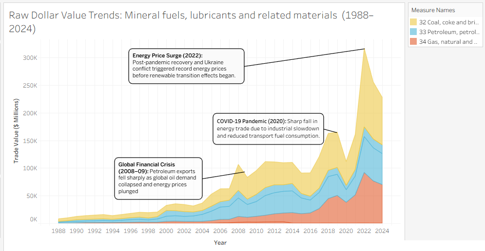
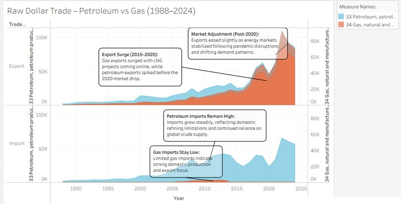
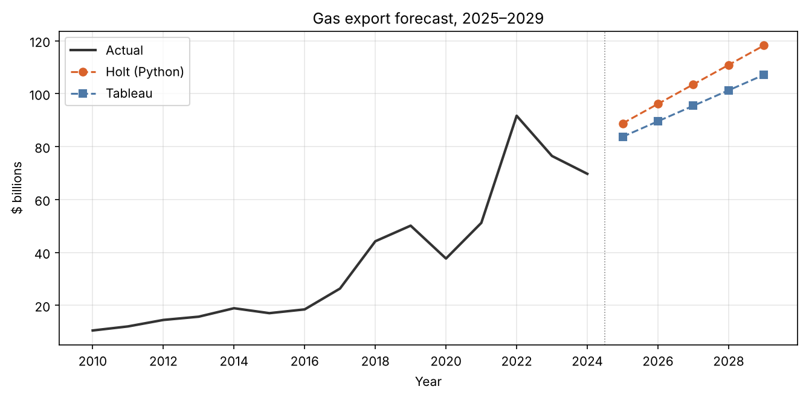

# Australian Mineral Fuel Trade & Gas Export Forecast

Analysis of Australian Bureau of Statistics (ABS) trade data from 1988 to 2024 for coal, petroleum and gas, with a 2025–2029 forecast of gas exports in Tableau and Python.

## Business problem

Mineral fuels are among Australia's most valuable exports, but they are exposed to global price shocks and the energy transition. The goal was to understand how the fuel trade has changed since 1988, how the major global shocks affected it, and where gas exports may be heading.

## Data

- ABS international merchandise trade, annual values in $ millions, 1988–2024
- Three mineral fuel groups: coal (SITC 32), petroleum (SITC 33) and gas (SITC 34), for both exports and imports
- `abs_mineral_fuel_trade.csv` contains the cleaned series used in the notebook

## Approach

1. **Data preparation (Excel):** cleaned the ABS tables and built raw dollar, statistical share and growth index views
2. **Visual analysis (Tableau):** 13 charts, two dashboards and a storyboard tracing trends, shocks and the shift towards gas
3. **Forecasting (Tableau and Python):** forecast gas exports for 2025–2029 with Tableau exponential smoothing and Holt's linear model (statsmodels), then backtested the method to check its reliability

## Key findings

- **Gas exports grew about fourfold**, from $17B in 2015 to $70B in 2024, as LNG projects came online. They peaked at $92B in the 2022 energy price spike.
- **Coal is still the largest fuel export** ($86B in 2024), with gas second.
- **Petroleum is a large net import.** Exports were $16B against imports of $56B in 2024, which shows Australia's reliance on imported fuel.
- The Global Financial Crisis (2008–09), COVID-19 (2020) and the 2022 price spike are all clearly visible as trade shocks.

## Forecast

| Year | Holt (Python) $B | Tableau $B |
|---|---|---|
| 2025 | 88.8 | 83.7 |
| 2026 | 96.1 | 89.6 |
| 2027 | 103.5 | 95.4 |
| 2028 | 110.9 | 101.3 |
| 2029 | 118.2 | 107.1 |

Both models expect continued growth, with Holt higher than Tableau in every year. However, both start well above the 2024 actual ($69.7B), even though exports fell in 2023 and 2024.

**Reliability check:** the same method trained on 2010–2019 and used to predict 2020–2024 had an average error of 21% (MAPE), with individual years off by up to 45%. It could not anticipate the COVID-19 drop or the 2022 price spike. The forecast is best read as a **growth scenario**, not a prediction.

## Recommendations

- Treat gas export forecasts as scenarios and plan for price-driven swings in either direction
- Reduce exposure to imported petroleum by strengthening fuel security
- Diversify energy exports as global demand shifts towards lower-carbon sources

## Limitations

- Only 10 annual observations were used to fit the forecast model
- Values are nominal and not adjusted for inflation or price changes
- The model uses no external drivers such as LNG prices, contracts or exchange rates

## Tools

Excel · Tableau · Python · pandas · statsmodels · Matplotlib

## Files

- `gas_export_forecast.ipynb`: data summary, Holt forecast, Tableau comparison and backtest
- `abs_mineral_fuel_trade.csv`: cleaned ABS data
- `.png` files: charts used in this README (`mineral_fuel_trade_trends.png`, `petroleum_vs_gas_trade.png` and `gas_export_forecast_tableau.png` are from the Tableau dashboard)
